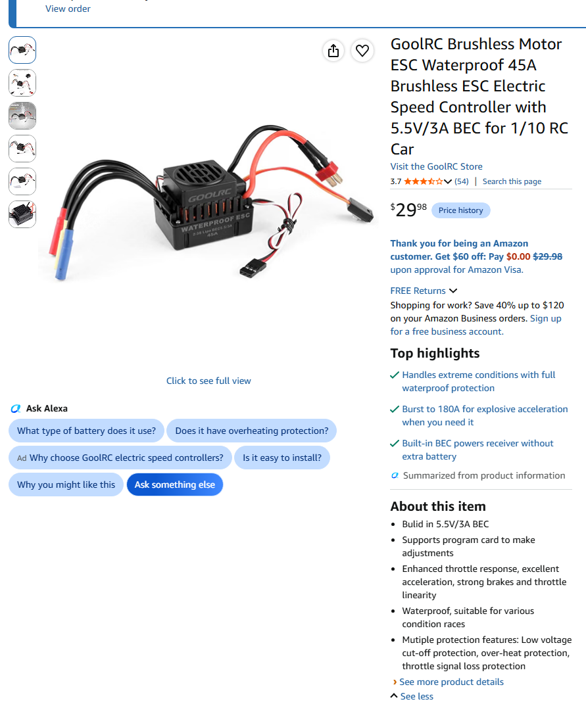
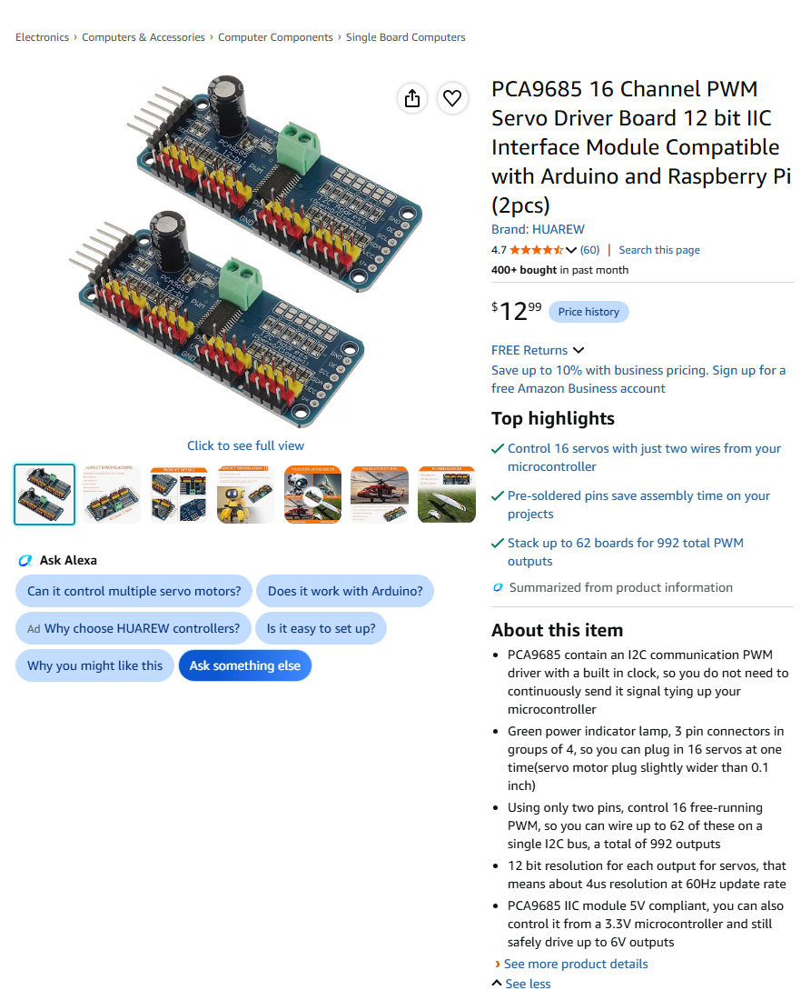
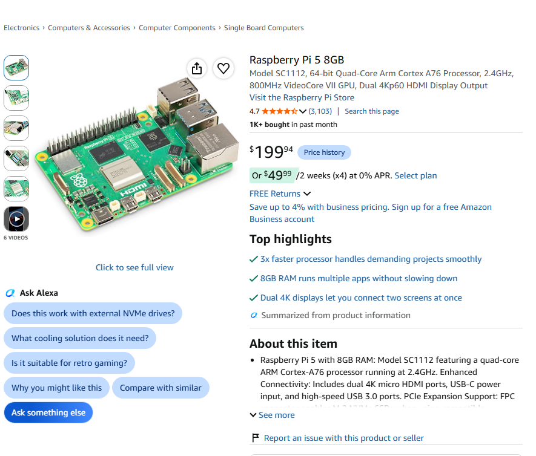
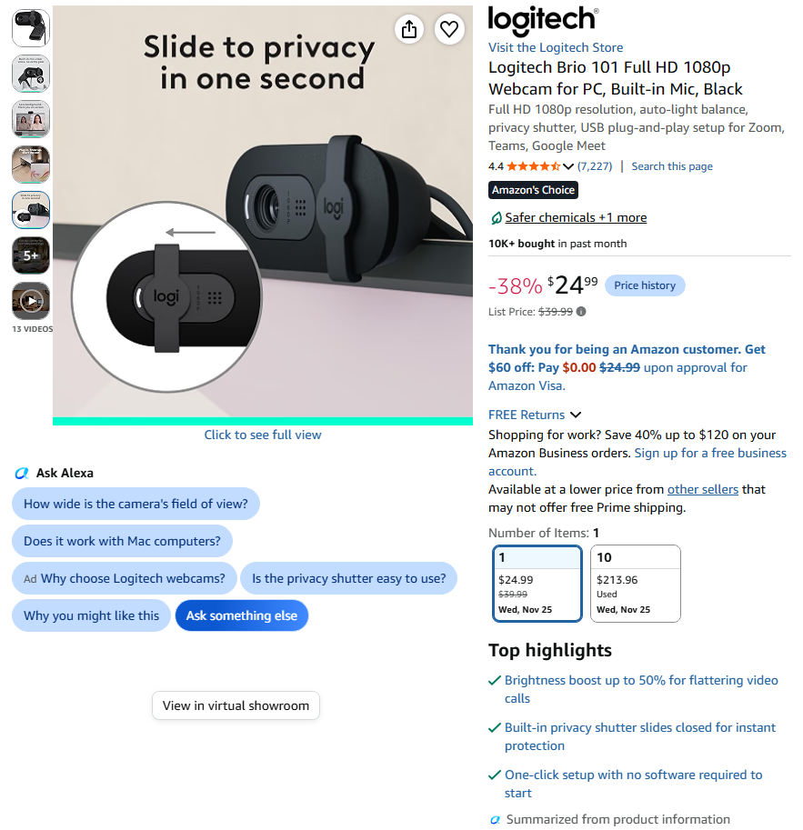
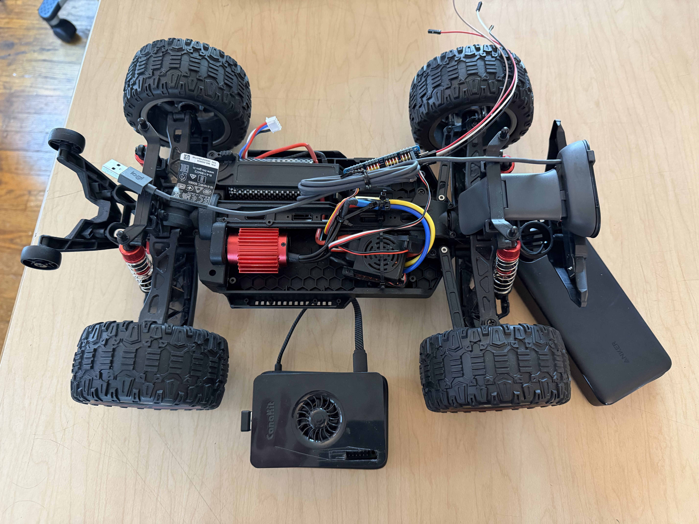
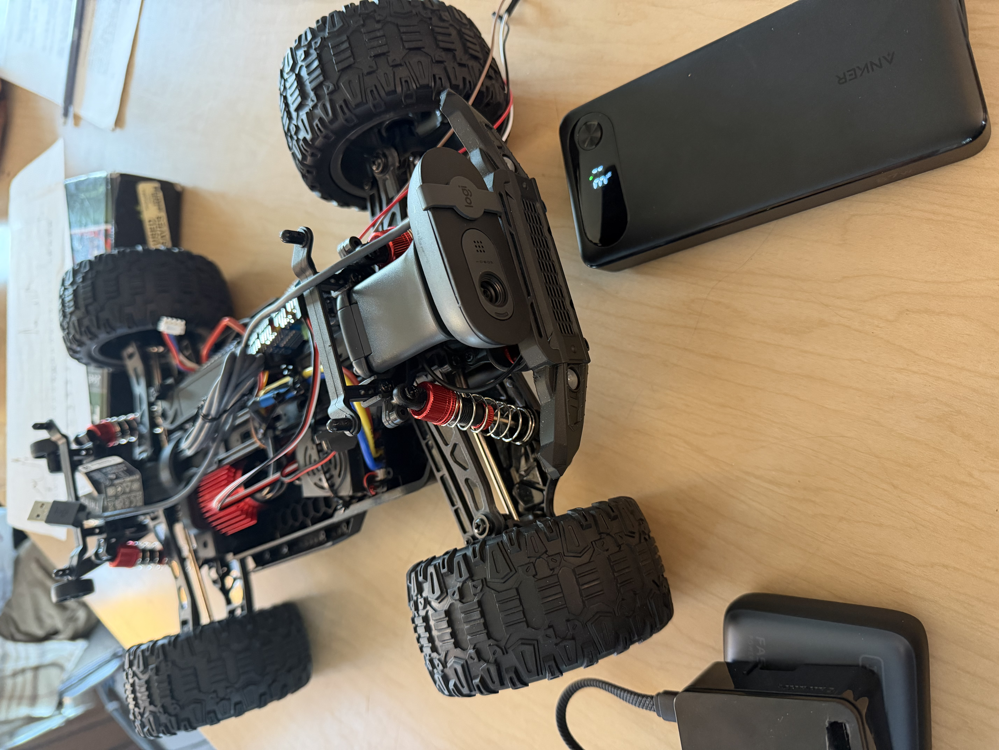
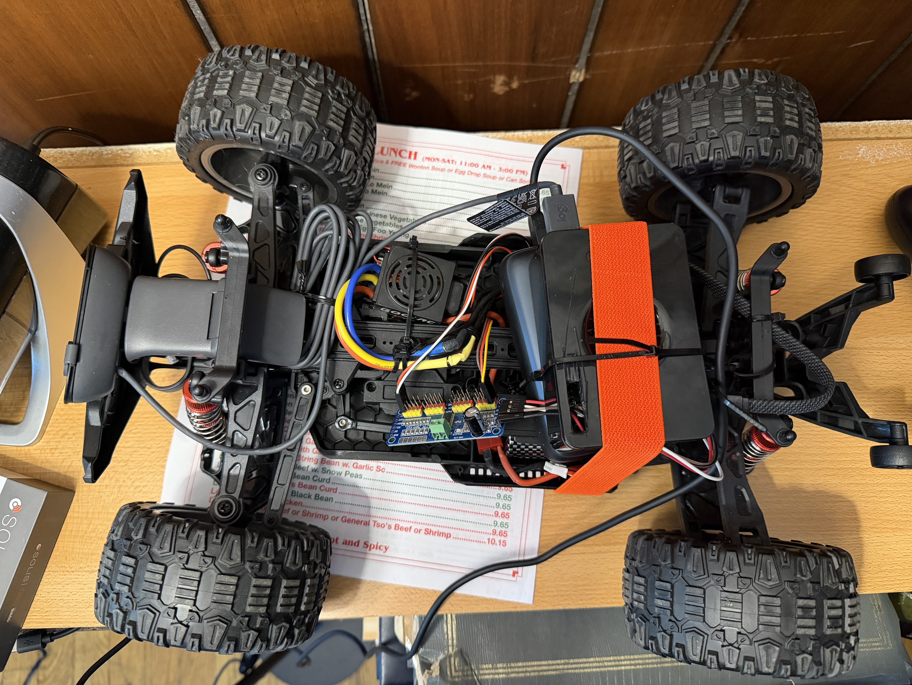
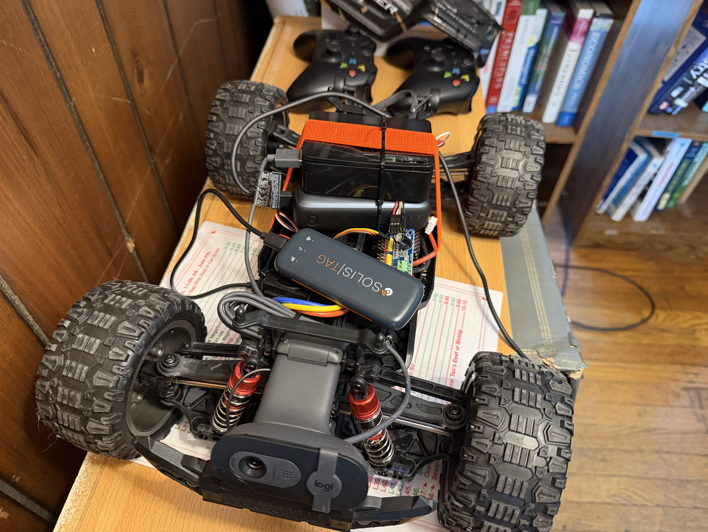

# CC — Physical Build Documentation

This document covers every physical component of the **Cellular-Controlled Car (CC)**: what each part is, why it was chosen, how everything is wired and powered, how to assemble the car from a stock RC truck, and how to bring the hardware up and test it safely.

For the overall project vision, software containers, and milestones, see the [Project Proposal](../CC_Proposal.pdf).


---

## Table of Contents

1. [System Overview](#1-system-overview)
2. [Bill of Materials](#2-bill-of-materials)
3. [Component Details](#3-component-details)
4. [Wiring & Pin Mapping](#4-wiring--pin-mapping)
5. [Power Distribution](#5-power-distribution)
6. [Assembly Guide](#6-assembly-guide)
7. [Power-On Order](#7-power-on-order)
8. [Operator Station](#8-operator-station)
9. [Safety & Operating Rules](#9-safety--operating-rules)
10. [Troubleshooting](#10-troubleshooting)
11. [Build Photos](#11-build-photos)
12. [Open Items](#12-open-items)

---

## 1. System Overview

CC is a 1:10 scale brushless RC truck whose stock 2.4 GHz radio receiver has been removed and replaced by a Raspberry Pi 5. The Pi gets internet access through a cellular hotspot, streams video from a USB webcam, and drives the steering servo and motor ESC through a PCA9685 PWM board. The driver sits at a remote station with an Xbox controller and a Meta Quest headset showing the car's camera feed.

```
                         OPERATOR STATION
 ┌──────────────────────────────────────────────────────────┐
 │  Xbox Wireless Controller ──► Controller relay script    │
 │  Meta Quest (HDMI passthrough) ◄── live video feed       │
 └──────────────────────────────────────────────────────────┘
                              ▲  │
                 video / telemetry  │  drive commands
                              │  ▼
               Internet ◄──► Cellular (4G LTE / 5G)
                       (WireGuard tunnel)
                              ▲  │
                              │  ▼
                           VEHICLE
 ┌───────────────────────────────────────────────────────────┐
 │  Solis Tag cellular hotspot  ──Wi-Fi──►  Raspberry Pi 5   │
 │                                             │   │         │
 │                    Logitech Brio 101 ──USB──┘   │ I2C     │
 │                                                 ▼ (0x40)  │
 │                                            PCA9685 PWM    │
 │                                             │       │     │
 │                                       Ch 15 │       │ Ch 0│
 │                                             ▼       ▼     │
 │                                  GoolRC 45A ESC   Steering│
 │                                             │      servo  │
 │                                             ▼             │
 │                                 2847 2300KV brushless     │
 │                                      motor (4WD)          │
 └───────────────────────────────────────────────────────────┘
```

**Design principles**

- **Separate power domains.** The Pi and its peripherals run from a USB power bank; the motor and steering run from the car's traction battery. Electrical noise and voltage sag from the motor can't brown out the Pi.
- **Hardware PWM.** The Pi never generates timing-critical PWM itself. It sends I2C commands to the PCA9685, which holds a steady 50 Hz signal on its own clock even if the Pi is busy encoding video.
- **Off-the-shelf, reversible.** Every part is commercially available and attached with zip ties, Velcro, and plug-in connectors. No permanent modification of the chassis is needed.

---

## 2. Bill of Materials

| # | Component | Part Used | Qty | Role | Link |
|:-:|:--|:--|:-:|:--|:--|
| 1 | RC chassis | DEERC 209E 1:10 Brushless 4WD RC Truck | 1 | Frame, suspension, drivetrain, steering servo, motor, battery | [Walmart / search](https://www.walmart.com/search?q=DEERC+209E) |
| 2 | ESC | GoolRC Waterproof 45A Brushless ESC (5.5 V / 3 A BEC) | 1 | Drives the brushless motor; BEC powers the servo rail | [Amazon](https://www.amazon.com/s?k=GoolRC+Waterproof+45A+Brushless+ESC) |
| 3 | PWM driver | HUAREW PCA9685 16-Ch 12-bit PWM Servo Driver (2-pack) | 1 used | I2C → PWM for ESC and steering servo | [Amazon](https://www.amazon.com/s?k=HUAREW+PCA9685) |
| 4 | Compute | Raspberry Pi 5, 8 GB (SC1112) in CanaKit case with fan | 1 | Runs all on-car software containers | [Amazon](https://www.amazon.com/s?k=Raspberry+Pi+5+8GB) |
| 5 | Camera | Logitech Brio 101 1080p USB Webcam | 1 | Driver POV video | [Amazon](https://www.amazon.com/s?k=Logitech+Brio+101) |
| 6 | Cellular | Solis Tag USB-C Mobile Wi-Fi Hotspot (SIMO) | 1 | Cellular backhaul; no SIM or contract needed | [Amazon](https://www.amazon.com/s?k=Solis+Tag+USB-C+Mobile+WiFi+Hotspot) |
| 7 | Pi power | Anker USB-C power bank (5 V / 3 A min. output) | 1 | Dedicated supply for Pi + peripherals | — |
| 8 | Traction power | LiPo pack included with DEERC 209E (T-plug) | 1+ | Motor and servo power | Included with car |
| 9 | Wiring | Female–female Dupont jumpers (×4) | 4 | Pi ↔ PCA9685 I2C + logic power | — |
| 10 | Mounting | Zip ties, Velcro strap | — | Securing Pi, power bank, PCA9685, ESC, cables | — |
| 11 | Controller | Xbox Wireless Controller | 1 | Driver input (operator station) | — |
| 12 | Display | Meta Quest headset (HDMI passthrough) | 1 | Driver display (operator station) | — |
| 13 | Capture | HDMI → USB-C UVC capture card | 1 | Feeds video into the Quest | **TODO** |

> **Stock parts reused from the DEERC 209E:** chassis, 4WD drivetrain, 2847 2300KV brushless motor, 3-wire steering servo, body shell, and LiPo batteries.
> **Stock parts removed:** the 2.4 GHz receiver and the stock ESC. The handheld transmitter is no longer used.

---

## 3. Component Details

### 3.1 DEERC 209E 1:10 Brushless RC Truck


The base platform. It was chosen because it is a hobby-grade 1:10 scale truck with a large, open chassis tub (room for a Pi, power bank, and PCA9685), a brushless drivetrain, and a standard 3-wire steering servo that accepts normal 50 Hz RC PWM.

- **Motor:** 2847 2300KV brushless, 3 bullet-connector leads
- **Drive:** 4WD, metal drive shafts, oil-filled shocks
- **Steering:** Stock 3-wire servo (signal / +V / GND)
- **Rated top speed:** 60+ km/h (37+ mph) stock. **Software must cap this.** See [Safety](#9-safety--operating-rules).

### 3.2 GoolRC 45A Brushless ESC



Replaces the stock ESC. It is a standalone hobby ESC with a standard 3-pin servo-style throttle input, so any 50 Hz PWM source can drive it. The stock unit was tied to the receiver.

- **Input:** 2–3S LiPo via T-plug (Deans)
- **Continuous current:** 45 A
- **BEC output:** 5.5 V / 3 A. This powers the PCA9685 servo rail and therefore the steering servo.
- **Protection:** Low-voltage cutoff, over-temperature, throttle-signal-loss protection
- **Leads:** 3 motor leads (bullet), 2 battery leads (T-plug), 1 three-pin signal lead (signal / BEC+ / GND), 1 power switch

### 3.3 PCA9685 16-Channel PWM Driver



A dedicated 12-bit PWM generator controlled over I2C. The Pi writes a target pulse width once and the board keeps outputting it on its own oscillator. That gives jitter-free servo and ESC signals with zero CPU load.

- **Interface:** I2C, default address `0x40`
- **Logic voltage (VCC):** 3.3 V–5 V. Fed 5 V from the Pi.
- **Servo rail (V+):** up to 6 V. Fed 5.5 V by the ESC's BEC.
- **Resolution:** 4096 steps per period (~4.9 µs per step at 50 Hz)
- **Channels used:** Ch 15 (throttle / ESC) and Ch 0 (steering servo)

### 3.4 Raspberry Pi 5 (8 GB)



The vehicle's main computer. It runs the Docker containers described in the proposal (Hardware Control, Video Capture & Streaming, and the Master API) and is the only device on the car that talks to the network.

- **CPU:** Quad-core Cortex-A76 @ 2.4 GHz. That's enough headroom for real-time video encoding alongside the control loop.
- **Case:** CanaKit case with active fan. Cooling matters because the Pi sits inside an enclosed body shell.
- **Connections:** GPIO header → PCA9685 (I2C), USB → webcam, Wi-Fi → Solis Tag hotspot, USB-C ← power bank

### 3.5 Logitech Brio 101 Webcam



A plug-and-play UVC webcam (1080p) that needs no drivers on Raspberry Pi OS. It is clipped onto the front bumper / body-post mount facing forward so the driver gets a low, first-person view. The built-in privacy shutter must be **open** when driving.

### 3.6 Solis Tag Cellular Hotspot


A USB-C powered mobile Wi-Fi hotspot that roams across carriers using a virtual SIM, with no SIM card or contract. The Pi joins its Wi-Fi network like any other access point, so no modem drivers or AT-command configuration are needed. It is USB-powered, so it draws from the car's USB power and needs no battery of its own.

> **Note:** A cellular hotspot sits behind carrier-grade NAT, so the car cannot accept inbound connections directly. All remote access goes through the project's **WireGuard** tunnel, initiated outbound from the Pi.

### 3.7 Power Bank (Pi Supply)

An Anker USB-C power bank mounted directly under the Pi case. It must supply **at least 5 V / 3 A** over USB-C. The Pi 5 will warn about and throttle USB peripheral current below that. It also powers the Solis Tag.

### 3.8 Traction Battery

The LiPo pack supplied with the DEERC 209E, connected to the ESC via T-plug. It powers the motor and, through the ESC's BEC, the steering servo. It is completely isolated from the Pi's power.

---

## 4. Wiring & Pin Mapping

### 4.1 Raspberry Pi 5 → PCA9685 (I2C + logic power)

Four female–female jumper wires from the Pi's 40-pin header to the PCA9685's 6-pin logic header.

| Raspberry Pi Pin | Function | PCA9685 Pin | Notes |
|:--|:--|:--|:--|
| Pin 2 | 5.0 V | VCC | Logic supply only. **Never** connect to V+ |
| Pin 3 | GPIO 2 / SDA | SDA | I2C data |
| Pin 5 | GPIO 3 / SCL | SCL | I2C clock |
| Pin 6 | GND | GND | Common ground reference |

```
 Raspberry Pi 5 header (top-left corner)        PCA9685 logic header
 ┌─────────────┐
 │ [1] 3V3   [2] 5V   │  Pin 2 ───────────────► VCC
 │ [3] SDA   [4] 5V   │  Pin 3 ───────────────► SDA
 │ [5] SCL   [6] GND  │  Pin 5 ───────────────► SCL
 │ [7] GP4   [8] TX   │
 │ [9] GND  [10] RX   │  Pin 6 ───────────────► GND
 └─────────────┘                                  (OE, V+ on this header: not connected)
```

> ⚠️ Do **not** use the Pi's 5 V pins (2 / 4) for V++ on the PCA9685. The PCA9685's logic header V+ pin is tied to the servo rail; connecting the Pi's 5 V there would back-feed the ESC's BEC into the Pi if both connected and would draw too much current to power the motor and servo.

### 4.2 PCA9685 → ESC and Steering Servo (PWM)

Both devices use standard 3-pin servo connectors that plug straight onto the PCA9685's channel headers. Match the wire colours to the header rows: **signal on PWM (yellow pin), red on V+, black/brown on GND.**

| PCA9685 Channel | Device         | Purpose             |
|-----------------|----------------|---------------------|
| Ch 15           | GoolRC ESC     | Throttle, 50 Hz PWM |
| Ch 0            | Steering servo | Steering, 50 Hz PWM |

**PWM signal reference (50 Hz, 20 ms period)**

| Pulse Width | Steering Servo         | ESC (Throttle)        |
|-------------|------------------------|-----------------------|
| ~2000 µs    | Full lock, one side    | Full reverse / brake  |
| 1550 µs     | Center                 | **Neutral (stopped)** |
| ~1000 µs    | Full lock, other side  | Full forward          |

> The 1000–2000 µs values are nominal. The **real** steering end-points are set during calibration so the servo never drives into the mechanical stops.
> Pulse ranges are backwards for unknown reason in wiring or setup.

### 4.3 ESC → Motor and Battery

| ESC Lead | Connects To | Connector |
|:--|:--|:--|
| 3 motor leads (blue / yellow / orange) | 2847 brushless motor | Bullet connectors |
| Red / black battery leads | LiPo traction battery | T-plug (Deans) |
| 3-pin signal lead | PCA9685 Ch 15 | Servo connector |

If the motor spins the wrong way for "forward," **swap any two of the three motor leads.** No software change is needed.

### 4.4 Common Ground

All grounds are tied together, which is required for the PWM signals to have a valid reference:

- Pi GND → PCA9685 logic GND (jumper on Pi pin 9)
- PCA9685 logic GND and servo-rail GND are joined on the PCA9685 board
- ESC GND → PCA9685 Ch 15 GND pin
- Servo GND → PCA9685 Ch 0 GND pin

The only thing **not** shared is positive supply: the Pi's 5 V and the BEC's 5.5 V never touch.

---

## 5. Power Distribution

```
  ┌──────────────────┐   USB-C 5V/3A    ┌────────────────┐  5V (pin 2)    ┌──────────────┐
  │ Anker power bank ├─────────────────►│ Raspberry Pi 5 ├───────────────►│ PCA9685 VCC  │
  └────────┬─────────┘                  └───────┬────────┘                │ (logic)      │
           │ USB                                │ USB                     └──────────────┘
           ▼                                    ▼
  ┌──────────────────┐                  ┌────────────────┐
  │ Solis Tag hotspot│                  │ Brio 101 webcam│
  └──────────────────┘                  └────────────────┘

  ┌──────────────────┐   T-plug        ┌────────────────┐  3-phase   ┌───────────────┐
  │ LiPo traction    ├────────────────►│ GoolRC 45A ESC ├───────────►│ 2847 motor    │
  │ battery          │                 └───────┬────────┘            └───────────────┘
  └──────────────────┘                         │ BEC 5.5V/3A via Ch 15 3-pin lead
                                               ▼
                                       ┌────────────────┐   Ch 1   ┌───────────────┐
                                       │ PCA9685 V+ rail├─────────►│ Steering servo│
                                       └────────────────┘          └───────────────┘
```

| Source | Output | Feeds | Via |
|:--|:--|:--|:--|
| Anker power bank | 5 V / 3 A (min) | Raspberry Pi 5 | USB-C power port |
| Anker power bank | 5 V USB | Solis Tag | USB-C (see [Open Items](#12-open-items)) |
| Raspberry Pi 5 | 5 V USB | Logitech Brio 101 | USB-A |
| Raspberry Pi 5 | 5V | PCA9685 logic (VCC) | Header pin 2 |
| LiPo battery | 2–3S (7.4–11.1 V) | GoolRC ESC | T-plug |
| GoolRC ESC BEC | 5.5 V / 3 A | PCA9685 V+ rail → steering servo | Ch 15 three-pin lead back-feeds the V+ rail |

**How the servo gets power.** The ESC's 3-pin lead carries the BEC output on its red wire. Plugging it into Ch 15 energizes the PCA9685's shared V+ rail, which then powers the steering servo on Ch 0. The PCA9685's green screw terminal is **left unconnected**. Do not also connect an external supply there, or two supplies will fight on the same rail.

**Why the BEC voltage is safe.** The PCA9685 V+ rail is rated to 6 V; the BEC outputs 5.5 V.

---

## 6. Assembly Guide

### 6.1 Tools & Supplies

- Small Phillips screwdrivers (chassis and body-post clips)
- Zip ties (assorted) and flush cutters
- Velcro strap (~25 mm wide)
- 4× female–female Dupont jumpers
- Multimeter (strongly recommended for polarity / voltage checks)
- Stand or box to lift the wheels off the bench

### 6.2 Step 1: Strip the Stock Electronics

1. Remove the body shell (pull the body clips) and disconnect the battery.
2. Unplug and remove the stock 2.4 GHz **receiver**.
3. Disconnect the stock ESC from the motor and battery leads and remove it.
4. Leave the **motor** and **steering servo** installed. Note the servo's 3-pin lead; it will later go to the PCA9685.

### 6.3 Step 2: Install the GoolRC ESC

1. Mount the ESC in the chassis tub where the stock ESC sat, oriented so its fan has airflow. Secure with zip ties.
2. Connect the three motor leads to the motor's bullet connectors.
3. Route the T-plug battery leads to the battery bay. **Do not connect the battery yet.**
4. Leave the ESC power switch **OFF**.

### 6.4 Step 3: Mount the PCA9685

1. Place the PCA9685 flat in the chassis tub beside the ESC, with the channel headers accessible and the logic header pointing toward where the Pi will sit.
2. Secure it with zip ties. Make sure no exposed pins can touch metal chassis parts or the motor heatsink.

### 6.5 Step 4: Connect ESC and Servo to the PCA9685

1. Plug the **ESC** 3-pin lead into **Ch 0**.
2. Plug the **steering servo** 3-pin lead into **Ch 1**.
3. Double-check orientation: dark wire (black/brown) on the **GND** row, red in the middle (**V+**), signal (white/orange/yellow) on the **PWM** row.
4. Bundle and zip-tie the servo leads away from the motor and drive shaft.

### 6.6 Step 5: Mount the Pi and Power Bank

1. Install the Pi 5 in the CanaKit case with the fan attached.
2. Stack the case on top of the Anker power bank at the **rear** of the chassis.
3. Strap the stack to the chassis with the Velcro strap, then add a zip tie through the strap for redundancy.
4. Connect the power bank to the Pi's USB-C power port with a short cable. **Leave the bank off.**

### 6.7 Step 6: Wire the Pi to the PCA9685

Run four female–female jumpers from the Pi header to the PCA9685 logic header exactly per [§4.1](#41-raspberry-pi-5--pca9685-i2c--logic-power). Route them through the case's GPIO slot. Leave a little slack so suspension travel can't pull them off.

### 6.8 Step 7: Mount the Camera

1. Clip the Logitech Brio 101 onto the front bumper / front body-post mount, lens facing forward and level.
2. Route its USB cable back along the chassis to a Pi USB port and zip-tie it clear of the steering linkage and front wheels at full lock.

### 6.9 Step 8: Install the Cellular Hotspot

1. Plug the Solis Tag into USB power. Place it on top of the chassis tub where it gets the best possible signal (not under the battery or directly against the motor).
2. Secure it so it can't slide into the drivetrain.

### 6.10 Step 9: Final Checks and Body Shell

1. Turn the wheels lock-to-lock by hand and roll the suspension through full travel. Confirm no cable snags, pulls, or rubs on a moving part.
2. Reinstall the body shell. Route the camera cable through a body-post hole so the shell sits flush.

---

## 7. Power-On Order

1. Power bank **ON**, then wait for the Pi to boot.
2. Start the hardware-control software (or a test script) so the PCA9685 is outputting **neutral (1500 µs)** on Ch 15.
3. Connect the LiPo to the ESC.
4. ESC switch **ON**. The ESC beeps and arms when it sees a steady neutral signal.

**Power-off is the reverse:** ESC off → unplug LiPo → shut down Pi → power bank off.

> If the ESC is switched on before the PCA9685 is outputting a valid signal, it may refuse to arm or arm with the wrong neutral point. Power-cycle the ESC once a neutral signal is present.

---

## 8. Operator Station

| Item | Purpose | Notes |
|:--|:--|:--|
| Xbox Wireless Controller | Steering (left stick) and throttle (triggers) | Read by the controller-relay script and forwarded to the Master API |
| Meta Quest headset | Driver display | Runs in HDMI passthrough mode showing the live camera feed |
| HDMI → USB-C UVC capture card | Bridges a computer's HDMI output into the Quest | Feed video to quest |
| Operator computer | Runs the relay script, decodes the video stream | Connects to the car over the WireGuard tunnel |

---

## 9. Safety & Operating Rules

**Runaway prevention**
- The Hardware Control Container must run a **watchdog**: if no valid drive command arrives for **> 500 ms** (cellular dropout, crashed relay, etc.), throttle goes to **neutral (1550 µs)** immediately.
- The ESC's built-in signal-loss protection is a second layer. If the PCA9685 or Pi loses power entirely, the ESC stops seeing pulses and cuts the motor.
- An **emergency stop** command must always be available to the operator and must bypass motion smoothing.

**Speed and steering limits**
- Stock top speed is 60+ km/h. Software throttle caps and speed presets must be in place before any driving over cellular, where latency makes high speeds uncontrollable.
- Steering is always clamped to the calibrated limits.

**Bench testing**
- Always put the car on a stand with the wheels free when testing control code, network code, or calibration indoors.

**LiPo battery care**
- Disconnect the traction battery immediately after driving. Never leave it connected in storage; the ESC's quiescent draw will deep-discharge and ruin the pack.
- Do not drive a pack below the ESC's low-voltage cutoff. Stop when power noticeably drops.
- Charge only with a LiPo balance charger, on a non-flammable surface, never unattended.
- Retire any pack that is puffy, dented, or hot.

**Thermal management**
- Let the ESC and motor cool between battery swaps.
- Make sure the Pi's case fan is running; the Pi sits under the body shell with limited airflow.

**Electrical**
- Never connect the Pi's 5 V to the PCA9685 V+ rail or the ESC's BEC line.
- Never connect a second supply to the PCA9685 screw terminal while the ESC is plugged into Ch 0.
- Check connector polarity with a multimeter before first power-up.

---

## 11. Build Photos

### Stage 1: ESC swap and initial wiring

Stock receiver removed and the GoolRC ESC installed. Motor and battery wiring completed, and the ESC and steering servo connected to the PCA9685. The Pi (CanaKit case) and power bank are not yet mounted.

| Top view | Front view with camera |
|:-:|:-:|
|  |  |

### Stage 2: Full integration

Pi 5 and power bank strapped to the rear of the chassis, PCA9685 mounted beside the ESC, Solis Tag hotspot installed, and the Brio 101 mounted on the front bumper.

| Top view | Angled view with hotspot |
|:-:|:-:|
|  |  |

### Stage 3: Body shell on

