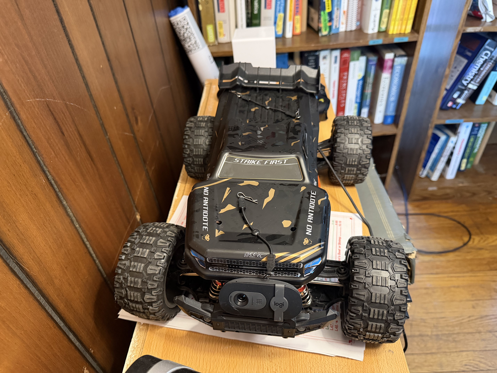
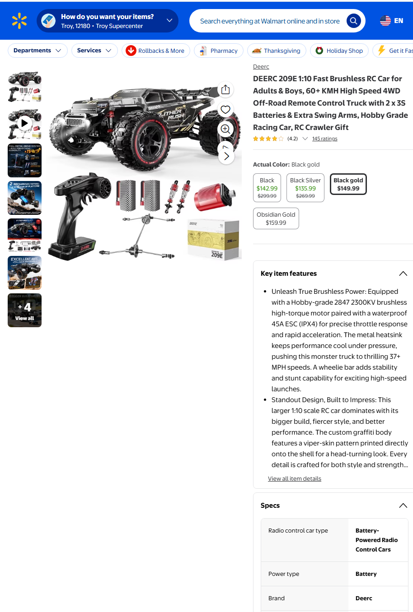

# CC — Physical Build Documentation

This document covers every physical component of the **Cellular-Controlled Car (CC)**: what each part is, why it was chosen, how everything is wired and powered, how to assemble the car from a stock RC truck, and how to bring the hardware up and test it safely.

For the overall project vision, software containers, and milestones, see the [Project Proposal](../CC_Proposal.pdf).



---

## Table of Contents

1. [System Overview](#1-system-overview)
2. [Bill of Materials](#2-bill-of-materials)
3. [Component Details](#3-component-details)
4. [Wiring & Pin Mapping](#4-wiring--pin-mapping)
5. [Power Distribution](#5-power-distribution)
6. [Assembly Guide](#6-assembly-guide)
7. [Power-On Order](#7-power-on-order)
8. [Operator Station](#8-operator-station)
9. [Safety & Operating Rules](#9-safety--operating-rules)
10. [Troubleshooting](#10-troubleshooting)
11. [Build Photos](#11-build-photos)
12. [Open Items](#12-open-items)

---

## 1. System Overview

CC is a 1:10 scale brushless RC truck whose stock 2.4 GHz radio receiver has been removed and replaced by a Raspberry Pi 5. The Pi gets internet access through a cellular hotspot, streams video from a USB webcam, and drives the steering servo and motor ESC through a PCA9685 PWM board. The driver sits at a remote station with an Xbox controller and a Meta Quest headset showing the car's camera feed.

```
                         OPERATOR STATION
 ┌──────────────────────────────────────────────────────────┐
 │  Xbox Wireless Controller ──► Controller relay script    │
 │  Meta Quest (HDMI passthrough) ◄── live video feed       │
 └──────────────────────────────────────────────────────────┘
                              ▲  │
                 video / telemetry  │  drive commands
                              │  ▼
               Internet ◄──► Cellular (4G LTE / 5G)
                       (WireGuard tunnel)
                              ▲  │
                              │  ▼
                           VEHICLE
 ┌───────────────────────────────────────────────────────────┐
 │  Solis Tag cellular hotspot  ──Wi-Fi──►  Raspberry Pi 5   │
 │                                             │   │         │
 │                    Logitech Brio 101 ──USB──┘   │ I2C     │
 │                                                 ▼ (0x40)  │
 │                                            PCA9685 PWM    │
 │                                             │       │     │
 │                                       Ch 15 │       │ Ch 0│
 │                                             ▼       ▼     │
 │                                  GoolRC 45A ESC   Steering│
 │                                             │      servo  │
 │                                             ▼             │
 │                                 2847 2300KV brushless     │
 │                                      motor (4WD)          │
 └───────────────────────────────────────────────────────────┘
```

**Design principles**

- **Separate power domains.** The Pi and its peripherals run from a USB power bank; the motor and steering run from the car's traction battery. Electrical noise and voltage sag from the motor can't brown out the Pi.
- **Hardware PWM.** The Pi never generates timing-critical PWM itself. It sends I2C commands to the PCA9685, which holds a steady 50 Hz signal on its own clock even if the Pi is busy encoding video.
- **Off-the-shelf, reversible.** Every part is commercially available and attached with zip ties, Velcro, and plug-in connectors. No permanent modification of the chassis is needed.

---

## 2. Bill of Materials

| # | Component | Part Used | Qty | Role | Link |
|:-:|:--|:--|:-:|:--|:--|
| 1 | RC chassis | DEERC 209E 1:10 Brushless 4WD RC Truck | 1 | Frame, suspension, drivetrain, steering servo, motor, battery | [Walmart / search](https://www.walmart.com/search?q=DEERC+209E) |
| 2 | ESC | GoolRC Waterproof 45A Brushless ESC (5.5 V / 3 A BEC) | 1 | Drives the brushless motor; BEC powers the servo rail | [Amazon](https://www.amazon.com/s?k=GoolRC+Waterproof+45A+Brushless+ESC) |
| 3 | PWM driver | HUAREW PCA9685 16-Ch 12-bit PWM Servo Driver (2-pack) | 1 used | I2C → PWM for ESC and steering servo | [Amazon](https://www.amazon.com/s?k=HUAREW+PCA9685) |
| 4 | Compute | Raspberry Pi 5, 8 GB (SC1112) in CanaKit case with fan | 1 | Runs all on-car software containers | [Amazon](https://www.amazon.com/s?k=Raspberry+Pi+5+8GB) |
| 5 | Camera | Logitech Brio 101 1080p USB Webcam | 1 | Driver POV video | [Amazon](https://www.amazon.com/s?k=Logitech+Brio+101) |
| 6 | Cellular | Solis Tag USB-C Mobile Wi-Fi Hotspot (SIMO) | 1 | Cellular backhaul; no SIM or contract needed | [Amazon](https://www.amazon.com/s?k=Solis+Tag+USB-C+Mobile+WiFi+Hotspot) |
| 7 | Pi power | Anker USB-C power bank (5 V / 3 A min. output) | 1 | Dedicated supply for Pi + peripherals | — |
| 8 | Traction power | LiPo pack included with DEERC 209E (T-plug) | 1+ | Motor and servo power | Included with car |
| 9 | Wiring | Female–female Dupont jumpers (×4) | 4 | Pi ↔ PCA9685 I2C + logic power | — |
| 10 | Mounting | Zip ties, Velcro strap | — | Securing Pi, power bank, PCA9685, ESC, cables | — |
| 11 | Controller | Xbox Wireless Controller | 1 | Driver input (operator station) | — |
| 12 | Display | Meta Quest headset (HDMI passthrough) | 1 | Driver display (operator station) | — |
| 13 | Capture | HDMI → USB-C UVC capture card | 1 | Feeds video into the Quest | **TODO** |

> **Stock parts reused from the DEERC 209E:** chassis, 4WD drivetrain, 2847 2300KV brushless motor, 3-wire steering servo, body shell, and LiPo batteries.
> **Stock parts removed:** the 2.4 GHz receiver and the stock ESC. The handheld transmitter is no longer used.

---

## 3. Component Details

### 3.1 DEERC 209E 1:10 Brushless RC Truck



The base platform. It was chosen because it is a hobby-grade 1:10 scale truck with a large, open chassis tub (room for a Pi, power bank, and PCA9685), a brushless drivetrain, and a standard 3-wire steering servo that accepts normal 50 Hz RC PWM.

- **Motor:** 2847 2300KV brushless, 3 bullet-connector leads
- **Drive:** 4WD, metal drive shafts, oil-filled shocks
- **Steering:** Stock 3-wire servo (signal / +V / GND)
- **Rated top speed:** 60+ km/h (37+ mph) stock. **Software must cap this.** See [Safety](#9-safety--operating-rules).

### 3.2 GoolRC 45A Brushless ESC


Replaces the stock ESC. It is a standalone hobby ESC with a standard 3-pin servo-style throttle input, so any 50 Hz PWM source can drive it. The stock unit was tied to the receiver.

- **Input:** 2–3S LiPo via T-plug (Deans)
- **Continuous current:** 45 A
- **BEC output:** 5.5 V / 3 A. This powers the PCA9685 servo rail and therefore the steering servo.
- **Protection:** Low-voltage cutoff, over-temperature, throttle-signal-loss protection
- **Leads:** 3 motor leads (bullet), 2 battery leads (T-plug), 1 three-pin signal lead (signal / BEC+ / GND), 1 power switch

### 3.3 PCA9685 16-Channel PWM Driver


A dedicated 12-bit PWM generator controlled over I2C. The Pi writes a target pulse width once and the board keeps outputting it on its own oscillator. That gives jitter-free servo and ESC signals with zero CPU load.

- **Interface:** I2C, default address `0x40`
- **Logic voltage (VCC):** 3.3 V–5 V. Fed 5 V from the Pi.
- **Servo rail (V+):** up to 6 V. Fed 5.5 V by the ESC's BEC.
- **Resolution:** 4096 steps per period (~4.9 µs per step at 50 Hz)
- **Channels used:** Ch 15 (throttle / ESC) and Ch 0 (steering servo)

### 3.4 Raspberry Pi 5 (8 GB)


The vehicle's main computer. It runs the Docker containers described in the proposal (Hardware Control, Video Capture & Streaming, and the Master API) and is the only device on the car that talks to the network.

- **CPU:** Quad-core Cortex-A76 @ 2.4 GHz. That's enough headroom for real-time video encoding alongside the control loop.
- **Case:** CanaKit case with active fan. Cooling matters because the Pi sits inside an enclosed body shell.
- **Connections:** GPIO header → PCA9685 (I2C), USB → webcam, Wi-Fi → Solis Tag hotspot, USB-C ← power bank

### 3.5 Logitech Brio 101 Webcam


A plug-and-play UVC webcam (1080p) that needs no drivers on Raspberry Pi OS. It is clipped onto the front bumper / body-post mount facing forward so the driver gets a low, first-person view. The built-in privacy shutter must be **open** when driving.

### 3.6 Solis Tag Cellular Hotspot


A USB-C powered mobile Wi-Fi hotspot that roams across carriers using a virtual SIM, with no SIM card or contract. The Pi joins its Wi-Fi network like any other access point, so no modem drivers or AT-command configuration are needed. It is USB-powered, so it draws from the car's USB power and needs no battery of its own.

> **Note:** A cellular hotspot sits behind carrier-grade NAT, so the car cannot accept inbound connections directly. All remote access goes through the project's **WireGuard** tunnel, initiated outbound from the Pi.

### 3.7 Power Bank (Pi Supply)

An Anker USB-C power bank mounted directly under the Pi case. It must supply **at least 5 V / 3 A** over USB-C. The Pi 5 will warn about and throttle USB peripheral current below that. It also powers the Solis Tag.

### 3.8 Traction Battery

The LiPo pack supplied with the DEERC 209E, connected to the ESC via T-plug. It powers the motor and, through the ESC's BEC, the steering servo. It is completely isolated from the Pi's power.

---

