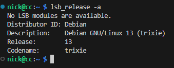
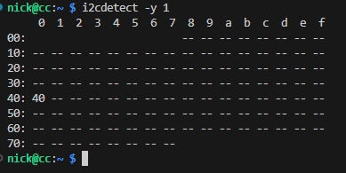
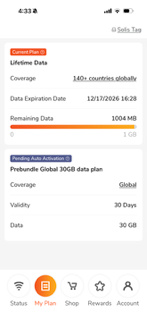
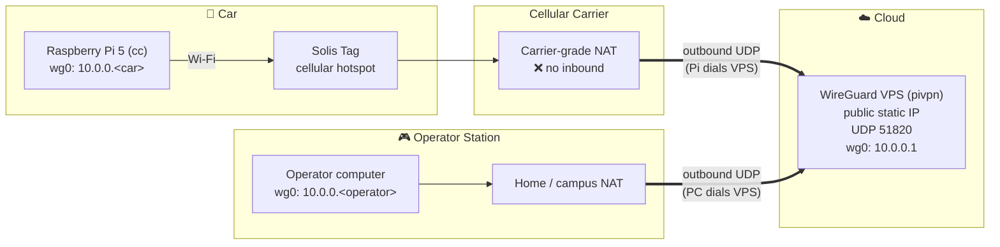
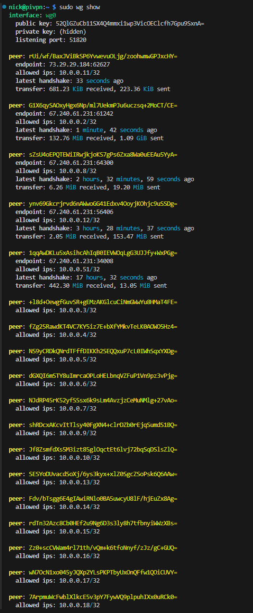

# CC — System Setup Documentation

This document covers the software and network setup that turns the assembled car into something you can drive from anywhere. It walks through installing Raspberry Pi OS on the Pi 5, enabling I2C, connecting the Pi to the Solis Tag cellular hotspot, and installing WireGuard. It then explains how the WireGuard VPS ties the car and the operator together.

For the hardware build (parts, wiring, power), see the [Physical Build Documentation](../Physical_Build_Info/readme.md). For the project overview, see the [Project Proposal](../CC_Proposal.pdf).

---

## Table of Contents

1. [Network Overview](#1-network-overview)
2. [Raspberry Pi Setup](#2-raspberry-pi-setup)
   - [2.1 Install Raspberry Pi OS](#21-install-raspberry-pi-os)
   - [2.2 First Boot](#22-first-boot)
   - [2.3 Enable I2C](#23-enable-i2c)
   - [2.4 Install WireGuard](#24-install-wireguard)
3. [Solis Tag Setup](#3-solis-tag-setup)
4. [WireGuard VPS](#4-wireguard-vps)
   - [4.1 Why a VPS Is Needed](#41-why-a-vps-is-needed)
   - [4.2 How It Connects](#42-how-it-connects)
   - [4.3 Peers Explained](#43-peers-explained)
5. [Verification Checklist](#5-verification-checklist)
6. [Troubleshooting](#6-troubleshooting)
7. [Open Items](#7-open-items)

---

## 1. Network Overview

| Device | Hostname | Role | Internet Connection | Tunnel IP |
|:--|:--|:--|:--|:-:|
| WireGuard VPS | `pivpn` | Hub. The only machine with a public IP; relays traffic between peers | Datacenter, public static IP | `10.0.0.1` |
| Raspberry Pi 5 (car) | `cc` | Peer. Runs the hardware, video, and API containers | Solis Tag cellular hotspot (Wi-Fi) | `10.0.0.<car>` |
| Operator computer | — | Peer. Runs the controller relay and receives the video feed | Any internet (home, campus, phone) | `10.0.0.<operator>` |

The tunnel subnet is **`10.0.0.0/24`** and WireGuard listens on **UDP 51820** on the VPS. `<car>` and `<operator>` stand for each device's assigned address (see [Open Items](#7-open-items)).

---

## 2. Raspberry Pi Setup

### 2.1 Install Raspberry Pi OS

The car runs **Raspberry Pi OS (64-bit)**, based on **Debian 13 "trixie"**. The Lite (headless) image is recommended: the car has no display, and skipping the desktop leaves more CPU and RAM for video encoding.

**You need:** a microSD card (32 GB+, A2 / U3 recommended), a computer with a card reader, and [Raspberry Pi Imager](https://www.raspberrypi.com/software/).

1. Open Raspberry Pi Imager.
2. **Device:** Raspberry Pi 5.
3. **Operating System:** *Raspberry Pi OS (other) → Raspberry Pi OS Lite (64-bit)*.
4. **Storage:** select the microSD card.
5. Click **Next → Edit Settings** and pre-configure the following:

   | Tab | Setting | Value |
   |:--|:--|:--|
   | General | Hostname | `cc` |
   | General | Username / password | Your admin user |
   | General | Wireless LAN | Solis Tag SSID and password (see [§3](#3-solis-tag-setup)). Optionally use your home Wi-Fi for first boot |
   | General | Wireless LAN country | `US` |
   | General | Locale | Your time zone |
   | Services | Enable SSH | ✅ Use public-key authentication (recommended) |

6. Write the card, insert it into the Pi, and power on from the power bank.

### 2.2 First Boot

SSH in using the wireguard peer ip:

```bash
ssh <user>@10.0.0.<car>
```

Update everything and install the basics:

```bash
sudo apt update && sudo apt full-upgrade -y
sudo apt install -y git curl i2c-tools v4l-utils
sudo reboot
```

Confirm the OS version:

```bash
lsb_release -a
```



> "No LSB modules are available" is a harmless message on Raspberry Pi OS and can be ignored.

### 2.3 Enable I2C

The Pi talks to the PCA9685 PWM board over I2C bus 1 (header pins 3 / 5). On Raspberry Pi OS this is a single `raspi-config` setting.

**1. Turn on I2C.** Either use the menu:

```bash
sudo raspi-config
# Interface Options → I2C → Yes → Finish
```

or do it in one command:

```bash
sudo raspi-config nonint do_i2c 0     # 0 = enable
```

Both add `dtparam=i2c_arm=on` to `/boot/firmware/config.txt`. Reboot:

```bash
sudo reboot
```

**2. Permissions.** The default user on Raspberry Pi OS is already in the `i2c` group, so no `sudo` is needed. If you created another user, add it to the group:

```bash
sudo usermod -aG i2c $USER     # then log out and back in
```

**3. Verify.** With the PCA9685 wired to the Pi (it only needs the Pi's 3.3 V; the car battery does not need to be connected):

```bash
ls /dev/i2c-*        # should include /dev/i2c-1
i2cdetect -y 1
```

The PCA9685 should show up at **`40`**:



> **Docker note:** containers do not see I2C by default. The Hardware Control Container must be started with `--device /dev/i2c-1`, or `devices: ["/dev/i2c-1:/dev/i2c-1"]` in Docker Compose.

### 2.4 Install WireGuard

WireGuard is in the standard Debian repositories and the kernel module is built in.

**1. Install:**

```bash
sudo apt install -y wireguard
```

**2. Get the car's tunnel config from the VPS.** The VPS runs **[PiVPN](https://pivpn.io/)**, which creates each peer's keys and config file on the server:

```bash
# On the VPS (done by whoever manages it)
pivpn add -n cc        # creates /home/<user>/configs/cc.conf
```

Copy that file to the Pi as `/etc/wireguard/wg0.conf`, then lock it down:

```bash
# On the Pi
sudo cp cc.conf /etc/wireguard/wg0.conf
sudo chmod 600 /etc/wireguard/wg0.conf
```

**3. Check the config.** It will look like this:

```ini
[Interface]
PrivateKey = <car private key: never share>
Address    = 10.0.0.<car>/24
DNS        = <set by PiVPN>
MTU        = 1280                    # add this: safe value for cellular + WireGuard overhead

[Peer]
PublicKey           = <VPS public key>
PresharedKey        = <set by PiVPN>
Endpoint            = <VPS public IP or hostname>:51820
AllowedIPs          = 10.0.0.0/24    # change from PiVPN's default 0.0.0.0/0, ::/0
PersistentKeepalive = 25             # REQUIRED: keeps the cellular NAT path open
```

Two edits to make to PiVPN's generated file:

- **`AllowedIPs = 10.0.0.0/24`.** PiVPN defaults to `0.0.0.0/0, ::/0`, which sends *all* of the car's internet traffic through the VPS. Limiting it to the tunnel subnet keeps updates and other traffic going straight out over cellular, and only tunnel traffic uses the VPS.
- **`PersistentKeepalive = 25`.** Add it if it isn't already there. Without it the car becomes unreachable after about a minute of idle time (see [§4.3](#43-peers-explained)).

**4. Start it and enable it at boot:**

```bash
sudo systemctl enable --now wg-quick@wg0
```

**5. Verify:**

```bash
sudo wg show          # "latest handshake" should be a few seconds ago
ping -c 4 10.0.0.1    # VPS reachable over the tunnel
```

---

## 3. Solis Tag Setup

The [Solis Tag](../Physical_Build_Info/readme.md#36-solis-tag-cellular-hotspot) is a USB-C powered cellular hotspot. It roams across carriers with a virtual SIM, so it needs no physical SIM card. The Pi connects to it over **Wi-Fi**, the same as any access point.

### 3.1 Activate the Hotspot

1. Power the Solis Tag from USB-C (the power bank or any USB port).
2. Install the **Solis** app, sign in, and activate the device. It comes with the **Lifetime Data** plan: 1 GB of global data, refreshed periodically.
3. Optionally add a larger plan in the app. A **Global 30 GB / 30-day** plan is queued for auto-activation for longer driving sessions.
4. Note the hotspot's **SSID and password** (shown in the app or on the device label). Change the default password if possible.
5. Confirm it has internet by connecting a phone to it first.



### 3.2 Connect the Pi

If you entered the Solis Tag Wi-Fi in Raspberry Pi Imager ([§2.1](#21-install-raspberry-pi-os)), this is already done. Otherwise, use NetworkManager, which Raspberry Pi OS uses for networking:

```bash
sudo nmcli dev wifi list                                         # find the Solis SSID
sudo nmcli dev wifi connect "<Solis Tag SSID>" password "<password>"
```

NetworkManager saves the connection and reconnects automatically on boot. To keep home Wi-Fi for bench work but have the car prefer the hotspot, connect to both once and then set priorities:

```bash
sudo nmcli connection modify "<Solis Tag SSID>" connection.autoconnect-priority 10
sudo nmcli connection modify "<Home Wi-Fi SSID>" connection.autoconnect-priority 5
```

### 3.3 Verify

```bash
nmcli -t -f active,ssid dev wifi | grep '^yes'   # connected SSID
iw dev wlan0 link                                # signal strength
ping -c 4 1.1.1.1                                # internet over cellular
```

### 3.4 Data Usage

Live video is by far the biggest data consumer, and the base plan is only **1 GB**:

| Stream Quality | Approx. Bitrate | Data per Hour | Driving on 1 GB |
|:--|:-:|:-:|:-:|
| 480p | ~1 Mbps | ~0.45 GB | ~2 hours |
| 720p | ~2.5 Mbps | ~1.1 GB | ~55 min |
| 1080p | ~5 Mbps | ~2.25 GB | ~25 min |

Set the stream bitrate in the Video Capture & Streaming Container with this in mind, and switch to the 30 GB plan for demos or long sessions. Recordings saved locally on the Pi use no cellular data.

---

## 4. WireGuard VPS

> This section explains **what** the VPS does and **why**. It does not cover setting up the VPS itself. The VPS runs WireGuard managed by **PiVPN**.

### 4.1 Why a VPS Is Needed

The car is online through a cellular hotspot, and **cellular connections cannot accept inbound connections**:

- **Carrier-grade NAT (CGNAT).** Mobile carriers put many subscribers behind a shared public IP. The Pi gets a private address with no public IP of its own, so there is nothing for the operator to connect to.
- **No port forwarding.** You can't open a port on a carrier's NAT, and the Solis Tag has no port-forwarding feature.
- **The IP changes.** As the Solis Tag roams between towers and carriers, the car's public-facing address changes without warning.

The operator's network usually has the same problem (home routers, campus networks, phone tethering). **Neither end can reach the other directly.**

The solution is a small cloud server (VPS) with a **public, static IP**. Both the car and the operator make **outbound** connections to it, and outbound connections are always allowed. The VPS then relays traffic between them over a private WireGuard network, where every device has a fixed `10.0.0.x` address no matter where it is physically connected.

### 4.2 How It Connects



**The same picture as plain text:**

```
   CAR                                    CLOUD                              OPERATOR
 ┌────────────┐                                                          ┌────────────┐
 │ Pi 5 (cc)  │                      ┌───────────────┐                   │ Operator PC│
 │ 10.0.0.x   │                      │ VPS (pivpn)   │                   │ 10.0.0.y   │
 └─────┬──────┘                      │ Public IP     │                   └─────┬──────┘
       │ Wi-Fi                       │ UDP :51820    │                         │
 ┌─────▼──────┐   ┌──────────┐       │ 10.0.0.1      │       ┌──────────┐      │
 │ Solis Tag  ├──►│ Carrier  ├──────►│               │◄──────┤ Home NAT │◄─────┘
 └────────────┘   │ CGNAT    │ out-  │   relays      │  out- └──────────┘
                  └──────────┘ bound │   x ⇄ y       │ bound
                                     └───────────────┘
   ✗ Operator → Car direct: blocked (CGNAT, no public IP)
   ✓ Car → VPS and Operator → VPS: outbound, always allowed
   ✓ Operator ⇄ Car: through the tunnel, via the VPS
```

**What a single drive command looks like:**

1. The operator's relay script sends a command to the Master API at the car's `10.0.0.x` address.
2. WireGuard on the operator PC encrypts it and sends it to the VPS.
3. The VPS decrypts it, sees which peer it's for, re-encrypts it for the Pi, and sends it down the Pi's existing tunnel.
4. The packet passes through the carrier's NAT. It's allowed, because it's the reply path of the Pi's own outbound connection.
5. The Pi decrypts it and hands it to the Master API.

Video and telemetry travel the same path in reverse.

### 4.3 Peers Explained

In WireGuard every device is a **peer**, identified by its public key. CC uses a **hub-and-spoke** layout: the VPS is the hub, and every other device only knows about the VPS.

**`sudo wg show` on the VPS:**



**How to read this output:**

- **`interface: wg0` / `listening port: 51820`.** The hub waiting for peers to dial in.
- **Each `peer:` block is one device**, identified by its public key. Each has exactly one tunnel IP (`allowed ips: 10.0.0.x/32`).
- **Peers with an `endpoint` and `latest handshake` are online.** The endpoint is the public IP and port the VPS *last saw that peer coming from*. These ports are random (e.g. `:62627`, `:61242`) because they are assigned by each peer's NAT. The VPS learns them from incoming traffic and never needs them configured. This is how the car stays reachable while its cellular address keeps changing.
- **Several online peers share the same endpoint IP with different ports.** These are multiple devices behind the same NAT, and each still gets its own tunnel.
- **Peers with only `allowed ips` are configured but not currently connected.** Their keys are registered, but they haven't sent a handshake since the VPS last restarted.
- **`transfer`** shows how much data has moved through each tunnel.

**How each side is configured:**

| Peer | Knows About | `Endpoint` | `AllowedIPs` | `PersistentKeepalive` |
|:--|:--|:--|:--|:-:|
| **VPS** (hub) | Every registered peer | *(none: learns them from handshakes)* | One `/32` per peer, e.g. `10.0.0.<car>/32` | — |
| **Pi** (car) | VPS only | `<VPS IP>:51820` | `10.0.0.0/24` | `25` |
| **Operator PC** | VPS only | `<VPS IP>:51820` | `10.0.0.0/24` | `25` |

**Key concepts:**

- **Keys.** Each peer has a private key (kept secret) and a public key (shared). The VPS lists the public key of every peer allowed to join; each spoke lists the VPS's public key. PiVPN also adds a pre-shared key per peer as an extra layer. A device that isn't registered can't connect.
- **`Endpoint`.** Where to send packets. Only the spokes set it, pointing at the VPS.
- **`AllowedIPs`.** This setting does two jobs:
  - *Outgoing:* traffic to these addresses goes into the tunnel. On the spokes, `10.0.0.0/24` means "send all tunnel traffic to the VPS." Normal internet traffic still goes out directly.
  - *Incoming:* packets from this peer are only accepted if they come from these addresses. On the VPS, each peer gets a single `/32`, so no device can impersonate another.
- **`PersistentKeepalive = 25`.** NAT devices forget idle connections, often within 30–60 seconds on cellular. If the Pi's mapping expires, the VPS can no longer reach it until the Pi sends something. A keepalive packet every 25 seconds keeps the path open so the car is always reachable. **It's required on the Pi.**
- **Relaying.** Because the spokes only peer with the VPS, Pi ⇄ operator traffic always passes through it. PiVPN enables IP forwarding on the VPS so it can route between peers.
- **Adding a peer** (e.g. a second operator or a spectator machine): run `pivpn add -n <name>` on the VPS and copy the generated config to the new device. No changes are needed on the Pi.

---

## 5. Verification Checklist

Run on the **Pi**:

| Check | Command | Expected |
|:--|:--|:--|
| OS | `lsb_release -a` | Debian GNU/Linux 13 (trixie) |
| I2C bus present | `ls /dev/i2c-1` | File exists |
| PCA9685 detected | `i2cdetect -y 1` | `40` shown |
| Camera detected | `v4l2-ctl --list-devices` | Brio 101 listed under `/dev/video*` |
| On the hotspot | `iw dev wlan0 link` | Connected to Solis Tag SSID |
| Internet | `ping -c 4 1.1.1.1` | Replies |
| Tunnel up | `sudo wg show` | Recent handshake (< 2 min) |
| VPS reachable | `ping -c 4 10.0.0.1` | Replies |
| WireGuard on boot | `systemctl is-enabled wg-quick@wg0` | `enabled` |

Run on the **operator PC**:

| Check | Command | Expected |
|:--|:--|:--|
| Car reachable | `ping 10.0.0.<car>` | Replies (typically 50–150 ms over cellular) |
| SSH over tunnel | `ssh <user>@10.0.0.<car>` | Logs in |

Run on the **VPS**:

| Check | Command | Expected |
|:--|:--|:--|
| Car connected | `sudo wg show` | Car's peer has an endpoint and a recent handshake |

---

## 6. Troubleshooting

| Symptom | Likely Cause | Fix |
|:--|:--|:--|
| `/dev/i2c-1` missing | I2C not enabled | `sudo raspi-config nonint do_i2c 0`, then reboot |
| `i2cdetect` → permission denied | User not in `i2c` group | `sudo usermod -aG i2c $USER`, then log out and back in |
| `i2cdetect` shows no `40` | Wiring | Check Pi pins 1 / 3 / 5 / 9 (see build doc §4.1) |
| Pi won't join Solis Tag | Wrong SSID / password, or hotspot not activated | `nmcli dev wifi list`; test the hotspot with a phone |
| Internet stops mid-session | Solis data used up | Check remaining data in the Solis app; activate the 30 GB plan |
| `wg show` shows no handshake | Wrong config, or VPS firewall blocks UDP 51820 | Re-copy the PiVPN config; confirm the peer exists on the VPS (`pivpn -l`) |
| Handshake OK but SSH / video hangs | MTU too large for cellular | Set `MTU = 1280` (or lower) in `wg0.conf` |
| Car reachable, then drops after ~1 min idle | No keepalive; cellular NAT mapping expired | Set `PersistentKeepalive = 25` on the Pi |
| All Pi traffic is slow | PiVPN default full tunnel (`0.0.0.0/0`) | Change `AllowedIPs` to `10.0.0.0/24` |
| High or spiky latency | Weak cellular signal | Move the Solis Tag to a better spot on the car; lower the video bitrate |